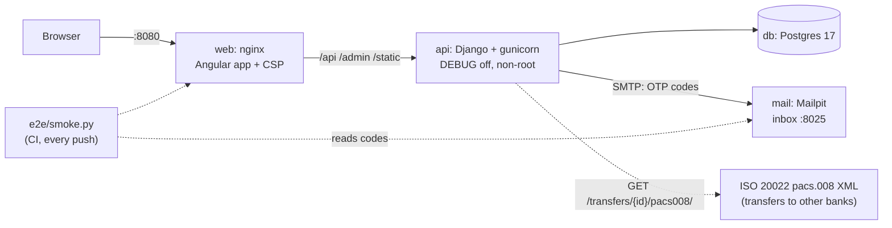

# Ledgerly Bank


A small, realistic banking app built **to be tested**. It's the shared system under test for my test-automation portfolio: Playwright, API, Cypress and Kubernetes projects all run against it, and the [Ask Ledgerly chatbot](https://github.com/HrishiPurandare/ai-quality-engineering-lab) answers questions about the same bank's policies.

Ledgerly Bank is fictional. All customers, accounts and money are invented test data.


## At a glance

| | |
|---|---|
| **What** | A fictional UAE bank: accounts, statements, beneficiaries with emailed codes, transfers with real limit rules, ISO 20022 `pacs.008` for payments to other banks |
| **Stack** | Django 5.2 LTS + DRF · Angular 21 (signals, zoneless) · Postgres 17 · nginx · Docker Compose · Mailpit |
| **Tests** | 161 API tests (+3 concurrency tests on real Postgres row locks) · 134 Angular unit tests · 29-check smoke test against the running containers |
| **CI** | 4 jobs on every push: API on SQLite and Postgres, front end (format, tests, build), and the whole Docker stack + smoke test |
| **Run it** | `docker compose up --build --wait` → http://localhost:8080 |

## How it fits together



## Bugs the tests caught while building it

The tests earned their place. A few of the real bugs they found:

1. **A race in the daily limit, caught by CI on Postgres.** Two transfers at the same instant could both pass the AED 50,000 check: the daily total was read up to the request's own clock, which was taken *before* waiting for the row lock. SQLite (one writer at a time) could never show it; the Postgres CI job did. Fixed, with a deterministic test.
2. **A failed code email left a beneficiary behind**, found by stopping the mail container: a 500, plus a "pending" beneficiary whose code would never arrive, so every retry failed as a duplicate. Now one transaction: no email, nothing saved, a clear `503 otp_not_sent`. The same experiment showed server errors weren't logged at all with DEBUG off.
3. **The security headers broke the page styles, only in production builds.** Angular inlines critical CSS and loads the rest with an inline `onload` handler, which the Content Security Policy blocks. Fixed in the build (not by weakening the CSP), and the smoke test now fails if an inline handler ever comes back; that was proven by putting the bug back.
4. **`?category=toString` passed validation**, because JavaScript's `in` also sees inherited properties. Found by a test written for exactly that case.
5. **Tests that couldn't fail.** A mutation check (breaking the code on purpose) showed dates looked right only because this machine is in Dubai's time zone, and that floats looked exact because `toFixed(2)` hid the error. Tests now run in UTC, with a large-number case.

## What's in it

| Area | Status |
|---|---|
| REST API: Django 5.2 LTS + Django REST Framework | ✅ |
| JWT login with rotating, blacklisted refresh tokens; rate-limited auth | ✅ |
| OpenAPI 3 spec (committed, checked in CI) + Swagger UI | ✅ |
| Accounts and statements (filters, pagination), owner-only access, deterministic seed data | ✅ |
| Beneficiaries (OTP by email) and transfers with the bank's real limit rules, idempotency and row locking | ✅ |
| ISO 20022 `pacs.008` messages for transfers to other banks (schema-validated, golden-file tested) | ✅ |
| Angular 21 front end: login, session refresh, route guards, `data-testid` everywhere | ✅ |
| Dashboard (exact totals) and statements (filters in the URL, pagination, Dubai time) | ✅ |
| Beneficiaries (add, emailed code, lock after 3 wrong codes) and transfers (review step, idempotent retries, plain-language limit errors) | ✅ |
| Docker Compose: Postgres, API (gunicorn, DEBUG off), web (nginx, CSP), Mailpit for OTP emails | ✅ |

## Run with Docker (the whole bank, one command)

```bash
echo "DJANGO_SECRET_KEY=$(openssl rand -base64 48 | tr -d '\n/+=')" > .env   # once
docker compose up --build --wait
```

| Open | What |
|---|---|
| http://localhost:8080 | The bank. Log in as `sara@example.com` / `Ledgerly-Demo-2026` (also `omar@`, `lina@`) |
| http://localhost:8025 | Mailpit: the inbox that catches OTP emails |
| http://localhost:8080/api/docs/ | API documentation (Swagger UI) |

Production-like on purpose: DEBUG off, gunicorn, Postgres 17, real SMTP, non-root containers, strict security headers, ports bound to localhost only. Demo data is created on the first start. `docker compose down -v` removes everything, including the database.

## Quick start (without Docker)

```bash
cd backend
python3.13 -m venv .venv && source .venv/bin/activate
pip install -r requirements-dev.txt
cp .env.example .env
python manage.py migrate
python manage.py seed             # demo customers: sara@ / omar@ / lina@example.com, password Ledgerly-Demo-2026
python manage.py runserver        # http://localhost:8000/api/docs
```

```bash
cd frontend                       # second terminal; Node 22
npm ci && npm start               # http://localhost:4200 (proxies /api to :8000)
```

## Tests

```bash
cd backend && pytest -q           # 159 API tests (+3 concurrency tests on Postgres)
cd frontend && npm test           # 132 Angular unit tests (Vitest, run in UTC)
```

```bash
docker compose up --build --wait && python3 e2e/smoke.py    # 29 checks against the running containers
```

CI builds the whole Docker stack on every push and runs the smoke test through nginx: security headers, login, a beneficiary confirmed with the code read from the test mail server, an idempotent transfer, and its pacs.008 message. It also runs every API test on **SQLite and Postgres 17**, fails on missing migrations, and fails if the committed `openapi.yaml` no longer matches the code (an unreviewed API contract change).

## Design choices

- **Secure by default.** Every endpoint needs a login unless it's on a four-item allowlist, and a test walks the OpenAPI schema to prove it: a new endpoint with a forgotten permission fails CI.
- **A customer only ever sees their own money.** Someone else's account is a 404 with the same body as an account that doesn't exist, so probing ids reveals nothing (OWASP API #1, broken object-level authorization).
- **Transfer rules come from the bank's published policy**, the same text the Ask Ledgerly chatbot answers from: AED 50,000 a day per customer across all accounts, AED 10,000 in the first 24 hours to a new beneficiary, up to 100 beneficiaries, OTP to add one. Each rule is tested at its exact boundary (AED 50,000.00 passes, 0.01 more is refused).
- **Money moves inside one database transaction with row locks**: the customer first (so two accounts can't both slip under the daily limit), then the accounts in id order (no deadlocks). Concurrency tests fire 10 transfers at the same instant on Postgres.
- **Idempotency keys**: a retried or double-clicked transfer replays the first response (`Idempotent-Replayed: true`) and never pays twice; reusing a key for a different transfer is a 409.
- **ISO 20022 pacs.008 for every transfer to another bank** (`GET /api/transfers/{id}/pacs008/`): built with lxml, validated against a subset XSD written from the published pacs.008.001.08 definition (real element names, order and data rules; not the official file), settlement date from the bank's 2 PM cut-off and the UAE Saturday–Sunday weekend, names escaped, and any DOCTYPE refused (XXE).
- **Money is `Decimal`, sent as a string** (`"1000.00"`), never a float.
- **Deterministic demo data.** The same seed always gives the same customers, IBANs (valid mod-97 check digits) and statements, and a test proves every balance equals the sum of its transactions. The seed command refuses to run with DEBUG off, because its passwords are public.
- **No user enumeration.** A wrong password and an unknown email get the same 401 response.
- **Refresh tokens rotate and the old one is blacklisted**, so a stolen, already-used refresh token can't be replayed.
- **The web app treats the session carefully**: an expired access token is refreshed silently, and requests that fail together share **one** refresh call (verified against the real API). If the refresh fails, the user lands on the login page with a "session expired" message and is sent back to where they were afterwards. `returnUrl` only accepts same-site paths, so the login page can't be used as an open redirect.
- **The statement's filters live in the URL**, so a filtered statement can be bookmarked, shared and undone with Back. The URL is treated as user input (junk like `?page=-1` or `?category=toString` never reaches the API), and `switchMap` cancels an older request when filters change, so a slow stale response can never overwrite a newer one.
- **The transfer screen never pays twice.** One `Idempotency-Key` per reviewed transfer, reused on every retry. A timeout or 5xx is shown as *"we can't tell whether it went through; trying again is safe"*, never as "failed" (which pushes people to start a second payment). Verified by stopping the API mid-transfer, restarting it and retrying: exactly one payment. Business errors carry a stable code (`data-error-code` on the page), so tests assert the rule, not the wording.
- **Money on screen is exact**: totals are added in whole cents (`BigInt`), never floats, and per currency. Dates are shown in Dubai time whatever the browser's time zone, and the unit tests run in UTC so a missing time zone fails on every machine, not only in CI.
- **Django 5.2 LTS**, not the newest 6.x: supported until 2028, and every dependency here is proven on it. Likewise **Angular 21 (LTS until mid-2027)**, because Angular 22 needs Node 22.22+.

## Limitations (on purpose, for now)

- **Fictional bank, local only.** No real payment network: transfers to other banks produce a `pacs.008` message and stay `PENDING`; nothing settles them.
- **The pacs.008 schema is a subset** written from the published definition (real element names, order and data rules), not the official ISO file.
- **Tokens are kept in `localStorage`** so tests can reuse a logged-in state. A production bank would use httpOnly cookies (the trade-off is documented in LEARN Part 5).
- **The Docker stack is plain HTTP on localhost.** HTTPS-only settings (HSTS, secure cookies, SSL redirect) switch on with `LEDGERLY_HTTPS=true` behind a TLS proxy.

## What's next

This repo is the system under test for the rest of the portfolio:
- **Playwright (TypeScript)**: UI tests on these screens: roles, saved login state, accessibility checks.
- **API tests**: contract tests from `openapi.yaml`, plus `pacs.008` schema checks.
- **Kubernetes**: the same images in a local cluster, with the smoke test as a Kubernetes Job.

## License

[MIT](LICENSE)
